# Nova Tables

Hi Future Developer,

Welcome to **Nova Tables**, a modern, high-performance desktop SQL client for **Microsoft SQL Server** built with **Tauri v2** and **Rust 2021**. It brings your connections, databases, tables, queries and results together in one calm workspace, so you can focus on the work instead of the tooling.

Nova Tables is made for people who work with Microsoft SQL Server every day and simply want a tidy place to look something up, write a query and read the answer. By moving from Electron to Tauri and Rust, it delivers lightweight binary sizes, lower memory consumption (~60–80MB), and instant native startup.

> **Note:** Nova Tables works with Microsoft SQL Server only. It is a local desktop application — nothing is uploaded anywhere, and neither your data nor your credentials ever leave your computer.

---

## Screenshots

### Your connections, in one place

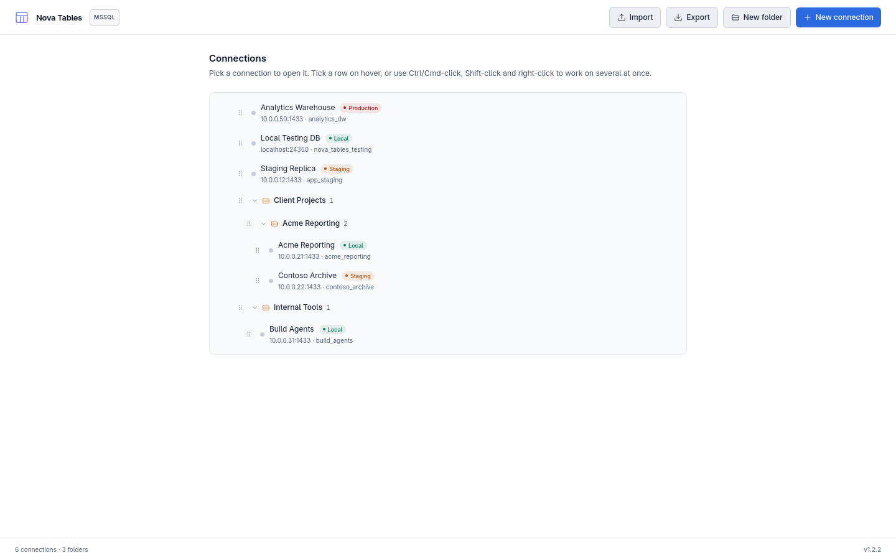

### Select several connections for bulk actions

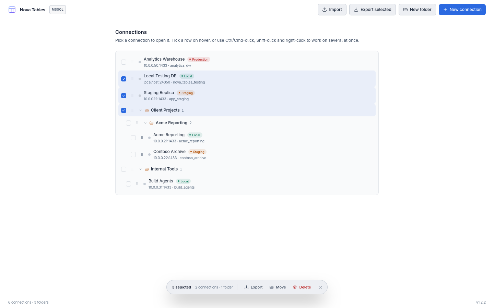

### Export connections and their folders as one encrypted file

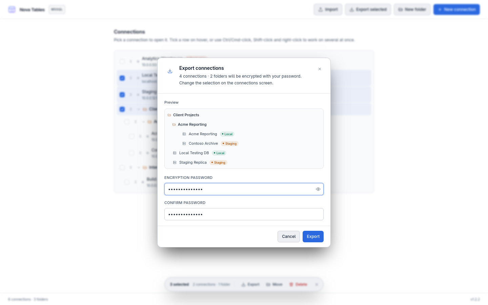

### Import the file on another machine with the same password

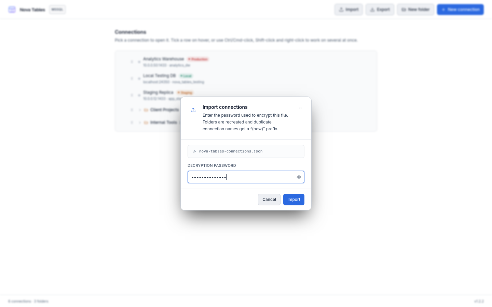

### A new connection, tested before it is saved

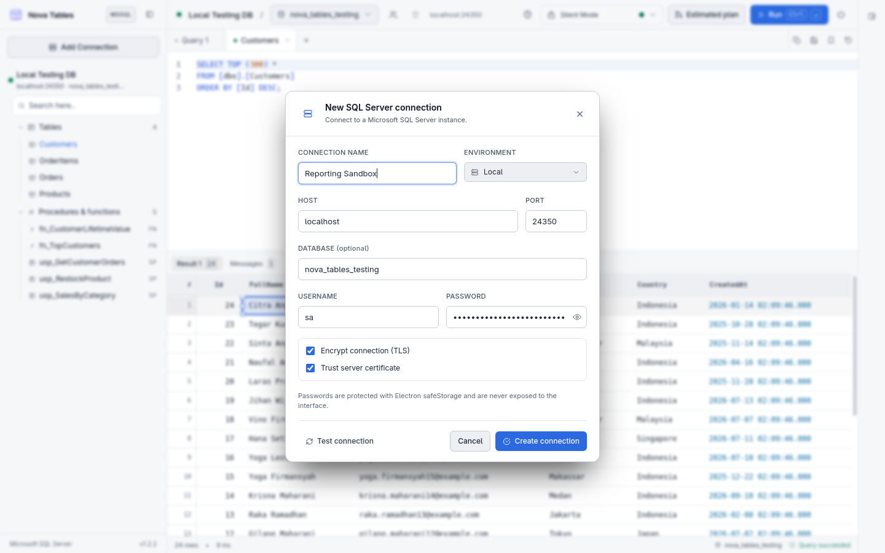

### Edit a whole block of cells at once

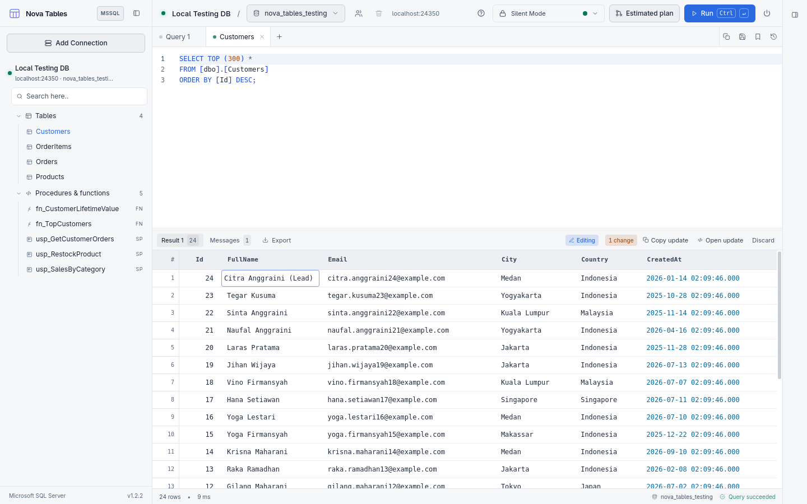

### Ready-to-run UPDATE statements from your edits

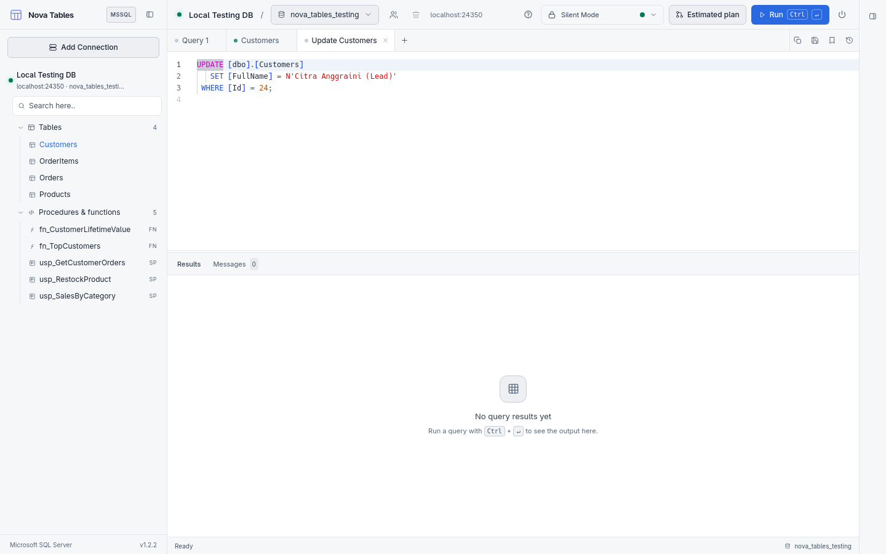

### Read a row as a JSON record

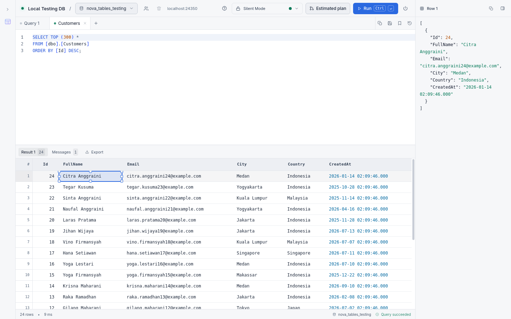

### Right-click a cell for edit, copy and delete actions

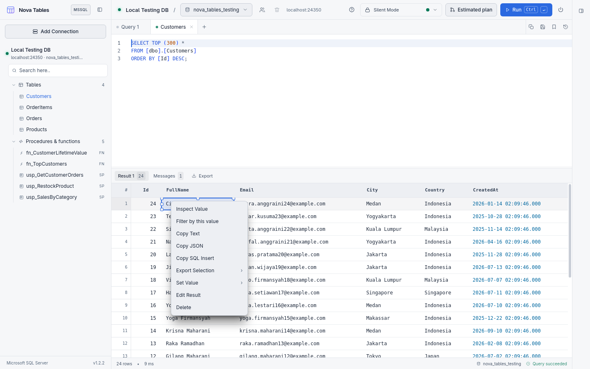

### Right-click a table for object actions

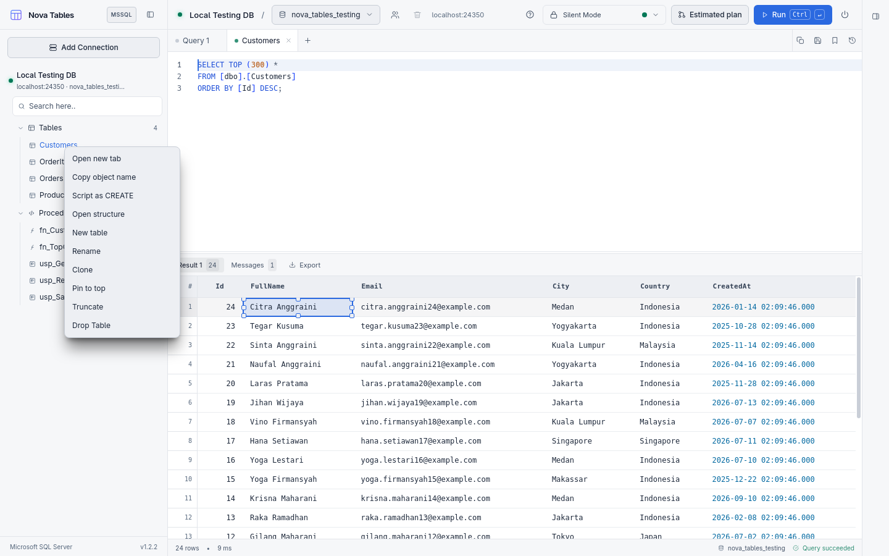

### Customise themes, fonts and editor typography

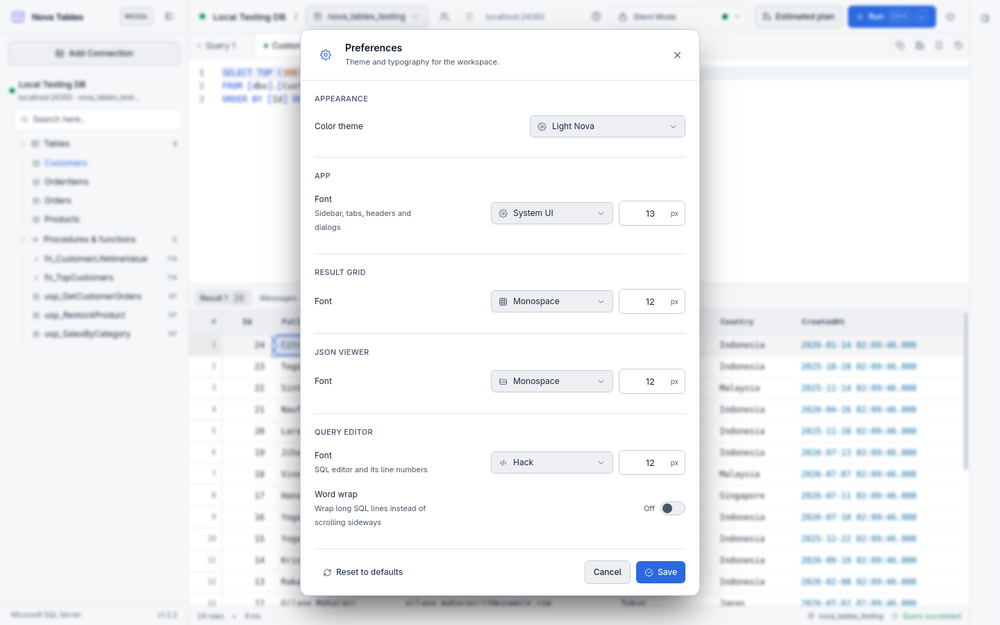

---

## Dazzling Tech Stack

- [Tauri v2](https://v2.tauri.app/) — Native desktop application framework
- [Rust 2021](https://www.rust-lang.org/) — High-performance native backend
- [React 18](https://react.dev/) — Sandboxed reactive UI
- [JavaScript](https://developer.mozilla.org/en-US/docs/Web/JavaScript) — Plain JavaScript (JSX) frontend, no TypeScript
- [Vite 5](https://vitejs.dev/) — Fast frontend build tool and dev server
- [Tailwind CSS](https://tailwindcss.com/) — Clean, semantic styling tokens
- [Monaco Editor](https://microsoft.github.io/monaco-editor/) — Editor engine, the same one behind VS Code
- [rusqlite](https://github.com/rusqlite/rusqlite) — Embedded SQLite store with WAL journal mode
- [tiberius](https://github.com/prisma/tiberius) & [tokio](https://tokio.rs/) — Native asynchronous TDS protocol for SQL Server
- [Microsoft SQL Server](https://www.microsoft.com/en-us/sql-server/) — Supported database engine

---

## What You Can Do

- **Connection Management**: Organize SQL Server connections with environment badges and collapsible, nested folders.
- **Recent Sessions & Quick Connect**: Jump back into recent connections with timestamp badges and dedicated quick-connect actions.
- **Encrypted Export & Import**: Password-protect your connection tree using AES-256-GCM and PBKDF2 encryption.
- **Tree Deletion Safety**: Safely delete entire folders and connection subtrees with atomic cascading in SQLite.
- **Database Navigation**: Browse databases with searchable filtering, and explore tables, views, stored procedures, and functions in a fast sidebar tree.
- **Monaco SQL Editor**: Write queries with syntax highlighting, auto-completion, line wrapping, execution guards (`silent`, `alert-readonly`, `alert`), and `Ctrl+R` re-run shortcut.
- **Table Designer**: Inspect and alter table structures visually with column drag-and-drop reordering, searchable data types, and foreign key reference pickers.
- **Interactive Results Grid**: View results with three-state column sorting, quick filtering by cell value, and foreign key link navigation.
- **In-Grid Row Editing & Deletion**: Edit cells or mark rows for deletion directly in the grid. Generate verifiable `UPDATE` and `DELETE` SQL statements without silent background modifications.
- **Execution Plan Inspection**: Analyze query performance with estimated visual execution plan trees (cost analysis and XML).
- **Exporting & History**: Export query results directly to RFC 4180 CSV or formatted JSON, and review query history anytime.
- **Theme & Typography**: Switch between dark and light themes (default: `Light Nova`), with responsive auto-detected font sizes (12px laptop / 14px large displays) persisted directly to SQLite.

---

## Quick Start & Development

### Prerequisites

- Node.js (v18+) & `npm`
- Rust toolchain (`cargo`, `rustc` 2021 edition)
- System libraries for Tauri on Linux: `libwebkit2gtk-4.1-dev`, `build-essential`, `curl`, `wget`, `file`, `libssl-dev`, `libgtk-3-dev`, `libayatana-appindicator3-dev`, `librsvg2-dev`

### Development Commands

```bash
# Install frontend dependencies
npm install

# Run Vite dev server with Tauri desktop window and HMR
make dev

# Build frontend assets with Vite
make compile

# Build and package the release binary (AppImage, deb, rpm)
make build

# Install locally to ~/.local/opt/nova-tables and add desktop launcher
make deploy
```

---

## Good to Know

- Saved connections live strictly on your computer inside the OS application data directory (`~/.local/share/nova-tables/connections.sqlite` on Linux or `%APPDATA%\nova-tables\connections.sqlite` on Windows).
- Passwords stored locally are isolated within the SQLite database.
- Several connections can stay open at once, and the one on screen owns the tree and tabs.
- Editing and row deletion are available for tables with a primary key, ensuring generated SQL statements accurately target primary key columns.
- Query execution and history remain 100% offline and local.

---

## Let's Connect

Need to chat? Feel free to drop me a line via [Email](mailto:novaardiansyah78@gmail.com) or hit me up on [WhatsApp](https://wa.me/6289506668480). I'm just a message away, ready to groove with you!

---

## Project Status


[](LICENSE)

---

## Code of Conduct

We believe in fostering a welcoming and inclusive environment for everyone. Please be respectful, considerate, and constructive in all interactions. By participating in this project, you agree to uphold our [Code of Conduct](CODE_OF_CONDUCT.md). Let's collaborate and make this community awesome together!

---

## Licensing Groove

This project is grooving to the rhythm of the [MIT License](LICENSE).

Feel free to use, modify, and share it with the world. Just remember to keep the original license intact. Let's spread the joy of coding together!

---

**Happy coding and collaborating!**  
- Nova Ardiansyah
